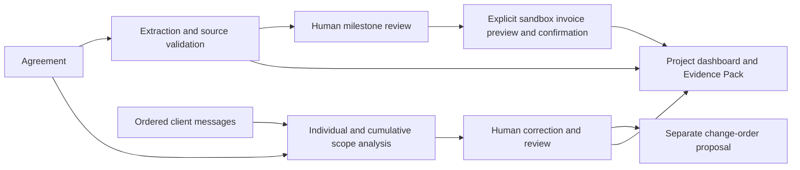

# ScopeShield — Devpost submission draft

**Draft only. Nothing submitted or published.** Replace pending links only with
verified, separately approved destinations. Do not copy private access credentials
into this text. Main demonstration is the core dashboard with synthetic data.

## Title and tagline

**ScopeShield**

*Turn client conversations into grounded scope decisions and explicit payment steps.*

## Inspiration / problem

A freelance project can change one message at a time. A headline revision becomes
a new section, an editing system, earlier delivery and ongoing support. The
freelancer needs a practical way to compare that conversation with the original
agreement and discuss additional work before accepting it. We focus on that
decision boundary rather than claiming measured savings or automated collections.

## What it does

ScopeShield stores an agreement, extracts reviewable milestones with source
quotations, and compares ordered client messages both individually and
cumulatively. The freelancer can inspect the exact contract/message evidence,
correct or reject conclusions, and prepare separate human-entered change-order
terms. Only an approved milestone can enter a distinct PayPal sandbox invoice
preview and confirmation workflow. A project dashboard and downloadable Evidence
Pack preserve the context for a negotiation.

The Cedar demonstration uses one fictional USD 1,500 project, five messages, one
human correction, a pending USD 300 proposal and a USD 500 **mocked** draft.
The proposal is not an AI valuation, agreed fee, loss estimate or recovered revenue.
No actual customer validation or payment is implied.

## How we built it

Next.js/React/TypeScript provides the review interface; FastAPI and SQLAlchemy
persist records in SQLite with Alembic migrations. Authentication uses individual
accounts, server-side cookie sessions, CSRF checks and project ownership. The
backend runs as a single process with bounded upload, PDF, password and AI work.

There is intentionally no automatic arrow from AI or a change order to an invoice.

## AI implementation and limits

The Gemini REST pipeline requests structured output and validates it locally.
Unsupported facts, source ranges and classifications cannot become definite
grounded findings merely because a model returned them. Chronological messages
retain stable IDs, roles, exact text and optional dates; they are not authenticated
imports. Cumulative conclusions require related message evidence and become
ambiguous when unresolved individual findings make certainty unsupported.

Original PDF quotations use validated extracted-text ranges and hash-bound
physical-page maps when available. Repeated/overlapping quotes never silently
select the first occurrence. Legacy/unverified provenance remains clearly
unverified. Exact quotations establish lexical grounding, not legal/semantic truth.

The recording uses explicitly fixed offline responses through the same validation
and persistence workflow. It is not a new Gemini run or a general offline LLM.
Earlier authorized real Gemini extraction and three-outcome single-request scope
comparison were verified separately; the newer cumulative Cedar analysis has
**not** been evaluated against live Gemini in this release preparation.

## PayPal implementation and limits

The existing direct-REST adapter is sandbox only. Human approval, exact amounts,
revision checks, durable invoice reservations, idempotency and read-only recovery
separate model output from invoice creation. Sending requires another explicit
confirmation; no capture, refund or production payment capability is demonstrated.

An earlier separately authorized **USD 1 sandbox draft creation and provider read**
was verified, without sending or paying. The Cedar video uses an in-memory adapter
and an INV2-MOCK draft: no PayPal invoice, email or payment exists from that run.
Local CREATED, provider status, simulated status and actual payment are not
interchangeable. No verified settlement or savings figure is claimed.

## Security and human authority

Owners control projects; clients cannot bypass freelancer review. Sessions and
mutations require server-side authorization and CSRF validation. Source records,
original AI output, edits and explicit approvals remain auditable. AI receives no
financial tools. Durable request/token budgets, concurrency guards, bounded PDF
processing and storage ceilings limit resource use. Evidence Pack PDFs include
private source JSON; a short executive brief must not be shared as if sanitized.

These are implemented controls exercised by offline regressions, not a claim of
certification or complete absence of defects. Public hosting remains unverified.

## Sponsor-tool usage

**APIMatic:** the official PayPal Context Plugin 0.4.1 informed the Day 21 token
lifetime/concurrency review and actual OAuth cache fix. It is a development-time
contribution; ScopeShield does not claim a generated Invoicing SDK or runtime
APIMatic dependency.

**AG Grid / AG Studio:** a separate local evaluation integrates Studio 3.0.0,
linked analytics, a custom evidence widget and a deterministic Agent Framework
runner with four supported queries and zero mutation tools. Core production
excludes Studio. Public judge/demo/media rights and prize eligibility remain
unconfirmed; the main video does not pretend the core table is Studio.

See [sanitized sponsor evidence](docs/sponsors/USAGE_EVIDENCE.md). Organizers decide
eligibility; no trial, paid licence or sponsor benefit has been activated here.

## Challenges encountered

Repeated quotations could be real text but have the wrong occurrence/page; we
reproduced that and made range validation fail closed, including overlaps.
Allowed retained data could exceed the off-host backup uploader; we aligned the
1 GiB database envelope with bounded encrypted transfer and rehearsed restoration
above 128 MiB. Duplicate messages could inflate analytics; source identity now
controls individual counts. Commercial evaluation rights needed a separate core
release strategy, and a fresh dependency download integrity failure was handled
without disabling checks.

## What we accomplished

A connected, persisted review workflow spanning agreement, messages, human
correction, proposal, approved-milestone invoicing, dashboard and source-backed
reports. The coherent Cedar flow is repeatable without live providers or a
commercial Studio licence. Security/release tests and actual screenshots are
recorded in [Day 24 readiness](DAY24_RELEASE_READINESS.md); they are verification
evidence, not customer-impact measurements.

## What is next

Evaluate cumulative analysis against a separately authorized real-model dataset;
improve larger-project analytics beyond complete-export bounds; resolve Studio
judging/distribution terms; and complete separately approved target-host HTTPS,
identity/firewall, backup and disaster-recovery acceptance. Any future conversation
integrations or payment capabilities need independent privacy and human-authority
design. No deployment or purchase is promised by this draft.

## Built with

Python, FastAPI, SQLAlchemy, SQLite, Alembic, Gemini REST, PayPal sandbox REST,
Next.js, React, TypeScript, ReportLab, pypdf, Playwright and Vitest.
Development context: APIMatic PayPal Context Plugin. Optional local evaluation:
AG Studio/React wrapper. Dependencies and assets retain their own licences.

## Submission links and media — pending approval

- Public source repository: `PUBLIC_REPOSITORY_URL_PENDING_APPROVAL`
- Reviewed source revision: `FINAL_PUBLIC_COMMIT_PENDING`
- Video, shorter than three minutes: `VIDEO_URL_PENDING_RECORDING_AND_APPROVAL`
- Runnable access: local installation instructions; hosted URL **none**.
- Original-code licence: MIT prepared in LICENSE, pending ownership confirmation.
- Screenshots: contract review, corrected conversation, mocked draft, core overview
  in docs/day24. Review captions/cropping before any upload.
- Optional sponsor clip URLs: none; AG Studio rights decision still pending.
- Judge test instructions: [INSTALL_GUIDE.md](INSTALL_GUIDE.md); use individual
  locally created accounts. No public/shared password.

The [official rules](https://paypalaihackathon.devpost.com/rules) require a public
source repository with a detectable open-source licence and a video shorter than
three minutes; a runnable local build is an access option. Recheck the organizer's
current deadline/form before final submission. Approval to prepare these drafts
is not approval to create a repository, upload media, submit, push or deploy.
